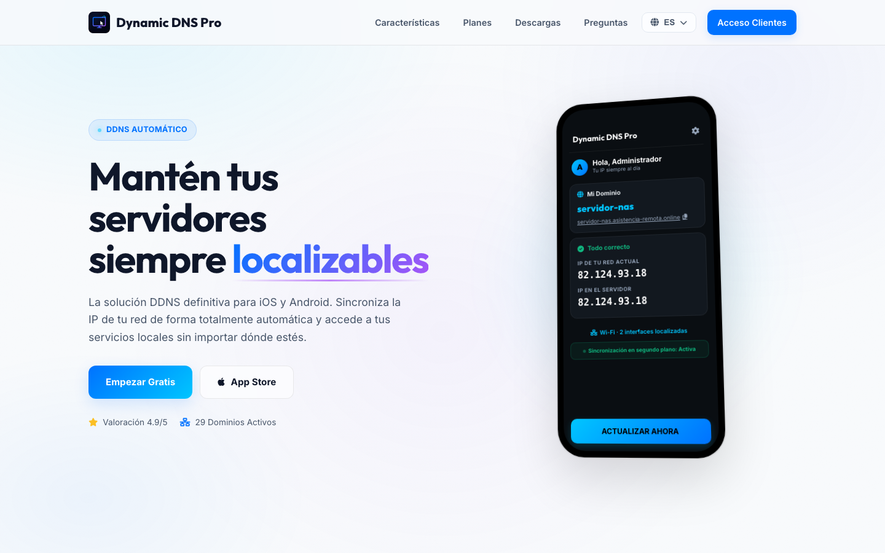

  

<h1 align="center">DDNSPro Remote</h1>

Vos machines, à un clic. Bureau à distance WebRTC sécurisé — visionneuse native pour macOS, hôte distant pour Windows.

  
  
  
  

🌍 <a href="README.es.md">🇪🇸 Español</a> · <a href="README.md">🇬🇧 English</a> · <a href="README.de.md">🇩🇪 Deutsch</a> · <strong>🇫🇷 Français</strong> · <a href="README.it.md">🇮🇹 Italiano</a> · <a href="README.pt.md">🇵🇹 Português</a>

> **Ce dépôt publie uniquement des releases binaires officielles** — le code source est privé. Téléchargements signés, checksums et flux d'auto-mise à jour.

## Téléchargement

| | |
|---|---|
|  **Visionneuse (macOS)** | [DDNSProRemote-macOS.dmg](https://github.com/mavksoft/dynamicdnspro-remote-releases/releases/latest) — client natif, signé Developer ID et notarié |
|  **Hôte distant (Windows)** | [DynamicDNSPro-Remote-Setup.exe](https://github.com/mavksoft/dynamicdnspro-releases/releases/latest) — à installer sur les machines à atteindre |
|  **Visionneuse web** | [remote.dynamicdnspro.com](https://remote.dynamicdnspro.com) — sessions complètes depuis tout navigateur, sans installation |
|  **Site officiel** | [dynamicdnspro.com](https://dynamicdnspro.com) — portail clients, offres et FAQ |

## Qu'est-ce que c'est

DDNSPro Remote est le produit d'accès à distance de l'écosystème Dynamic DNS Pro — sous licence séparée, mais partageant votre compte, vos machines et vos permissions avec le portail web. Installez l'hôte sur les machines administrées, puis accédez-y depuis la visionneuse macOS native ou n'importe quel navigateur : bureau, fichiers, console et actions d'alimentation via WebRTC chiffré de bout en bout.

## Fonctionnalités

- **Sessions WebRTC P2P** — vidéo bureau, audio et saisie à faible latence, chiffrées DTLS de bout en bout.
- **Accès par consentement** — le côté distant approuve chaque session (ou autorisation permanente/de reconnexion par machine).
- **Gestionnaire de fichiers** — parcourir les lecteurs distants, glisser-déposer les envois et téléchargements dans la session.
- **Lobby des machines** — vos machines avec miniatures en direct, ou connexions ponctuelles par ID + mot de passe.
- **Sélecteur de session RDP** — sur les hôtes multi-sessions, choisir une session existante ou en ouvrir une nouvelle.
- **Contrôle de résolution** — changer la résolution distante à chaud (profils admin).
- **Attente de reconnexion** — redémarrez la machine distante : la session attend et se rattache toute seule.
- **Actions d'alimentation** — redémarrage, verrouillage, Ctrl+Alt+Suppr / SAS, Win+D depuis la barre de session.
- **Presse-papiers, curseur distant, clavier & souris** — parité totale avec la visionneuse web.
- **Mises à jour signées** — manifestes Ed25519 ; builds macOS notariés par Apple.
- **Six langues** — ES / EN / FR / IT / DE / PT.

## Mode d'emploi

1. Inscrivez-vous sur [dynamicdnspro.com](https://dynamicdnspro.com) et activez une offre Remote.
2. Sur chaque machine cible, installez l'**hôte Remote Windows** — il s'enregistre sous votre compte avec un ID machine.
3. Définissez la politique d'accès par machine : consentement à chaque fois, toujours autoriser, ou autoriser avec délai de grâce de reconnexion.
4. Ouvrez la **visionneuse macOS** (ou le lobby web), connectez-vous — vos machines apparaissent avec leur statut en direct.
5. Clic sur une machine → la session s'ouvre : bureau, fichiers et actions d'alimentation dans une seule fenêtre.

## Contenu de ce dépôt

- `DDNSProRemote-macOS-<version>.dmg` — installateur de la visionneuse macOS (Developer ID + notarié)
- `DDNSProRemote-macOS-<version>.zip` — paquet de mise à jour pour l'updater intégré
- `visor_macos.json` — manifeste de version signé (Ed25519) lu par l'auto-updater
- `visor_macos_appcast.xml` — flux Sparkle hérité pour les installations antérieures à 1.1.0
- `*.sha256` — checksums de chaque binaire

[Dernière release](https://github.com/mavksoft/dynamicdnspro-remote-releases/releases/latest)

## FAQ

**Le trafic est-il chiffré ?**
Oui — les sessions passent par WebRTC avec DTLS-SRTP ; la signalisation transite par TLS authentifié. Rien ne circule en clair et le consentement/les politiques sont appliqués côté hôte.

**Faut-il un abonnement Dynamic DNS Pro ?**
Remote est licencié séparément — vous pouvez l'acheter seul. Si vous avez déjà un compte, il partage votre login et votre liste de machines.

**Différence entre visionneuse et hôte ?**
La visionneuse (ce dépôt) est ce que *vous* exécutez pour vous connecter ; l'hôte (dans `dynamicdnspro-releases`) tourne sur la machine distante.

**Connexion sans compte possible ?**
Oui — les sessions ponctuelles fonctionnent avec l'ID et le mot de passe de la machine distante, comme les outils d'assistance classiques.

## Support

- Site & portail clients : [dynamicdnspro.com](https://dynamicdnspro.com)
- Lobby web Remote : [remote.dynamicdnspro.com](https://remote.dynamicdnspro.com)
- Email : support@it-systems.es

---

DDNSPro Remote · © MavkSoft / IT-Systems

